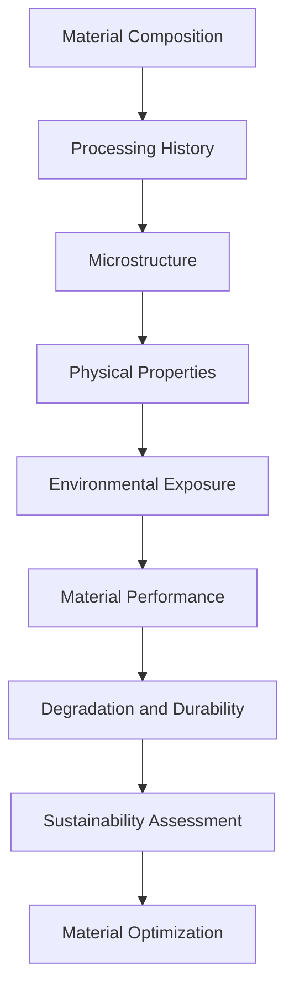
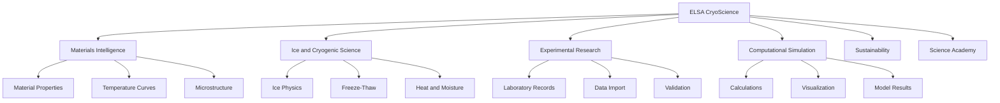
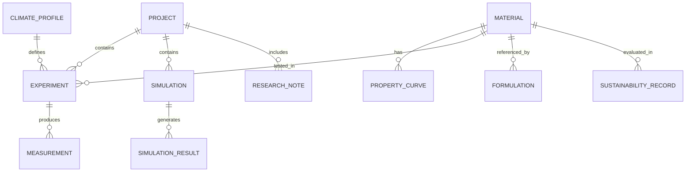

# ELSA CryoScience
### Decoding the Physics of Extreme Cold.

<p align="center">
  <strong>Advanced Materials Science · Cryogenic Research · Cold-Climate Engineering · Computational Physics</strong>
</p>

<p align="center">
  An interactive scientific research platform for exploring ice, understanding material behaviour, investigating extreme temperatures, and studying the engineering of cold environments.
</p>

---

## Table of Contents

1. [Project Overview](#1-project-overview)
2. [Vision and Scientific Mission](#2-vision-and-scientific-mission)
3. [Core Features](#3-core-features)
4. [Technology Stack](#4-technology-stack)
5. [Installation and Getting Started](#5-installation-and-getting-started)
6. [Application Navigation](#6-application-navigation)
7. [Scientific Architecture](#7-scientific-architecture)
8. [Materials Intelligence Database](#8-materials-intelligence-database)
9. [Temperature-Dependent Material Properties](#9-temperature-dependent-material-properties)
10. [Ice Physics and Cryogenic Science](#10-ice-physics-and-cryogenic-science)
11. [Freeze–Thaw and Durability Research](#11-freeze-thaw-and-durability-research)
12. [Heat Transfer and Moisture Transport](#12-heat-transfer-and-moisture-transport)
13. [Experimental Research Laboratory](#13-experimental-research-laboratory)
14. [Simulation and Computational Science](#14-simulation-and-computational-science)
15. [Artificial Intelligence and Material Discovery](#15-artificial-intelligence-and-material-discovery)
16. [Sustainability and Life-Cycle Assessment](#16-sustainability-and-life-cycle-assessment)
17. [Data Architecture and Mock Datasets](#17-data-architecture-and-mock-datasets)
18. [User Experience and Interactive Environment](#18-user-experience-and-interactive-environment)
19. [Testing, Scientific Integrity and Limitations](#19-testing-scientific-integrity-and-limitations)
20. [Roadmap, Contributions and Project Information](#20-roadmap-contributions-and-project-information)

---

# 1. Project Overview

## 1.1 Introduction

**ELSA CryoScience** is an advanced, interactive scientific research platform dedicated to the physics of extreme cold and the behaviour of materials under challenging environmental conditions.

The platform combines materials science, thermodynamics, heat transfer, cryogenic science, ice physics, experimental research, computational simulation, material discovery, and sustainability.

Its central purpose is to provide a unified environment where users can explore the relationship between temperature, material composition, microstructure, moisture, mechanical performance, durability, and environmental exposure.

ELSA CryoScience transforms the concept of an ice laboratory into an interactive computational research environment.

Users can investigate questions such as:

- How do materials respond to extremely low temperatures?
- How does temperature influence thermal conductivity?
- What causes freeze–thaw deterioration?
- How does moisture move through porous materials?
- How do steel, timber, concrete, and polymers behave differently in cold environments?
- How does ice form and develop crystalline structures?
- How can thermal performance be improved?
- How can material performance be compared across environmental scenarios?
- How can experimental data support better material selection?

The platform is designed to make scientific information accessible while providing deeper technical interfaces for advanced users.

## 1.2 Official Identity

| Attribute | Description |
|---|---|
| Product name | ELSA CryoScience |
| Full identity | Extreme Low-Temperature Science & Advanced Materials Laboratory |
| Official slogan | Decoding the Physics of Extreme Cold. |
| Primary discipline | Computational materials science |
| Research specialization | Cold-climate engineering |
| Scientific focus | Ice, snow, temperature, materials and environmental exposure |
| Application type | Interactive scientific research and educational platform |
| Primary interface | Web application |
| Core identity | Advanced winter science laboratory |

## 1.3 Core Research Domains

ELSA CryoScience connects the following scientific disciplines:

1. Materials science and engineering.
2. Thermodynamics.
3. Heat transfer.
4. Ice physics.
5. Snow science.
6. Cryogenic engineering.
7. Moisture transport.
8. Mechanical behaviour.
9. Freeze–thaw durability.
10. Computational materials research.
11. Experimental characterization.
12. Materials optimization.
13. Environmental engineering.
14. Sustainable materials.
15. Scientific visualization.

## 1.4 Primary Objective

The primary objective is to move beyond a conventional materials database.

Instead of storing only fixed material properties, ELSA CryoScience connects:

**Composition → Processing → Microstructure → Properties → Performance → Degradation → Sustainability**

This relationship forms the foundation of the platform's scientific architecture.

---

# 2. Vision and Scientific Mission

## 2.1 Vision

The long-term vision of ELSA CryoScience is to become an integrated computational research environment for understanding and improving material performance in cold and extreme environments.

The platform brings together scientific data, mathematical models, experimental observations, computational workflows, and interactive visualization.

Its purpose is to make complex scientific relationships easier to investigate and communicate.

## 2.2 Mission

The mission is to help users:

- Explore the physical behaviour of ice and snow.
- Understand material behaviour at low temperatures.
- Investigate thermal and moisture-related processes.
- Compare material properties.
- Organize experimental research.
- Explore numerical simulation.
- Discover material alternatives.
- Understand uncertainty and scientific evidence.
- Evaluate environmental performance.
- Build reproducible research projects.

## 2.3 Research Philosophy

ELSA CryoScience follows five principles.

### 1. Scientific transparency

Every important result should explain where its data came from and how it was generated.

### 2. Material-specific physics

Different materials have different degradation mechanisms and physical behaviours. Models must respect those differences.

### 3. Reproducibility

Research calculations and experiments should preserve their inputs, assumptions, configurations, and versions.

### 4. Visual scientific communication

Graphs, diagrams, tables, interactive models, and 3D visualizations should help users understand scientific behaviour.

### 5. Responsible computational research

Predictions and simulations must not be represented as certified experimental results or engineering approvals.

## 2.4 Target Users

ELSA CryoScience is designed for:

- Materials science students.
- Mechanical engineering students.
- Civil and structural engineers.
- Materials researchers.
- Building science researchers.
- Cold-climate engineering specialists.
- Computational scientists.
- Sustainability researchers.
- Educators.
- Scientific software developers.
- Users interested in the physics of ice and extreme environments.

---

# 3. Core Features

ELSA CryoScience integrates a collection of interconnected research modules.

| Module | Primary purpose |
|---|---|
| Research Dashboard | Scientific activity and dataset overview |
| Materials Intelligence | Search, inspect and compare materials |
| Temperature Laboratory | Investigate temperature-dependent properties |
| Ice Physics | Explore ice formation and physical behaviour |
| Cryogenic Science | Study low-temperature environments |
| Freeze–Thaw Laboratory | Investigate repeated freezing and warming |
| Heat Transfer | Explore conduction and thermal behaviour |
| Moisture Science | Study diffusion, absorption and condensation |
| Mechanical Testing | Explore material strength and deformation |
| Microstructure Explorer | Inspect internal material structure |
| Experiment Manager | Create and organize research experiments |
| Simulation Centre | Configure and inspect computational models |
| Material Discovery | Explore material candidates and optimization |
| AI Research Assistant | Support scientific exploration |
| Sustainability | Evaluate environmental material information |
| Climate Research | Compare environmental scenarios |
| Research Library | Store technical information and research notes |
| Equation Explorer | Explore scientific equations |
| Science Academy | Learn scientific concepts |
| Research Journal | Record observations and findings |

## 3.1 Interactive Research Dashboard

The dashboard provides an overview of the scientific environment.

It presents information about:

- Available material records.
- Temperature-dependent datasets.
- Experimental records.
- Research projects.
- Simulation configurations.
- Climate profiles.
- Material comparisons.
- Recent research activity.
- Data quality indicators.

All dashboard metrics are intended to be derived from the underlying application data.

## 3.2 Search and Discovery

A global scientific search experience supports discovery across the platform.

Users can find:

- Materials.
- Properties.
- Experiments.
- Equations.
- Research records.
- Climate scenarios.
- Simulation configurations.
- Projects.
- Technical concepts.

## 3.3 Interactive Research Workflow

A typical ELSA CryoScience workflow is:

1. Select a material.
2. Inspect its scientific properties.
3. Review temperature-dependent behaviour.
4. Select an environmental scenario.
5. Explore relevant experimental evidence.
6. Configure a calculation or simulation.
7. Inspect the results.
8. Compare alternative materials.
9. Record research observations.
10. Export the resulting information.

---

# 4. Technology Stack

## 4.1 Application Architecture

ELSA CryoScience uses a modular web application architecture.

The existing application is based on a React and Vite frontend, with JavaScript and CSS used for application logic, interface development, and styling.

The architecture separates major scientific modules so they can be maintained and expanded independently.

## 4.2 Core Technologies

| Technology | Role |
|---|---|
| React | Component-based user interface |
| Vite | Development server and build tooling |
| JavaScript | Application logic and interactions |
| CSS | Visual presentation and responsive layouts |
| JSON | Structured scientific demonstration data |
| Browser storage | Local application persistence |
| Chart components | Scientific data visualization |
| 3D visualization layer | Interactive ice-palace and material views |

The application architecture is designed to support later integration with additional scientific libraries, numerical solvers, external databases, and laboratory systems.

## 4.3 Modular Design

The application separates:

- User interface components.
- Scientific calculations.
- Material data models.
- Experiment records.
- Simulation configurations.
- Data generation.
- Visualization.
- Storage.
- Application services.

This structure reduces unnecessary coupling between the scientific modules.

## 4.4 Extensibility

Future integrations may include:

- PostgreSQL.
- Python scientific services.
- Numerical simulation engines.
- Finite-element software.
- Computational fluid dynamics tools.
- Molecular simulation tools.
- Laboratory data acquisition systems.
- External environmental datasets.
- Engineering CAD and BIM systems.

These are integration opportunities and should not be assumed to be active connections unless actually configured.

---

# 5. Installation and Getting Started

## 5.1 Requirements

To run the application locally, install:

- Node.js.
- npm.
- Git.
- A modern browser.
- A development environment such as Visual Studio Code or Replit.

## 5.2 Clone the Repository

```bash
git clone YOUR_REPOSITORY_URL
```

Enter the project directory:

```bash
cd elsa-cryoscience
```

## 5.3 Install Dependencies

```bash
npm install
```

## 5.4 Run the Development Server

```bash
npm run dev
```

Open the local development address provided by Vite in your browser.

The exact address is displayed in the terminal when the development server starts.

## 5.5 Production Build

To create a production build:

```bash
npm run build
```

## 5.6 Preview the Production Build

```bash
npm run preview
```

## 5.7 Running on Replit

To run the project inside Replit:

1. Open the ELSA CryoScience project.
2. Install the project dependencies.
3. Start the development workflow.
4. Open the application preview.
5. Navigate to the Research Dashboard.

The Replit configuration should use the appropriate development command defined in the project.

## 5.8 Data Storage

The local-first application supports browser-based persistence for relevant application records.

Depending on the configured storage implementation, saved projects and experiments may remain associated with the same browser profile and device.

Users should export important research records regularly.

Browser storage should not be treated as a substitute for a backed-up laboratory database.

---

# 6. Application Navigation

## 6.1 Research Command Centre

The Research Command Centre provides the main entry point to ELSA CryoScience.

It presents:

- Research summaries.
- Dataset statistics.
- Recent projects.
- Recent experiments.
- Material activity.
- Simulation activity.
- Research shortcuts.

## 6.2 Materials Intelligence

The Materials Intelligence module provides detailed material profiles and comparison tools.

Users can search by material name, family, property, temperature range, or data category.

## 6.3 Cryogenic Research

The Cryogenic Research section explores the behaviour of materials and physical systems at low temperatures.

## 6.4 Ice Physics

The Ice Physics environment focuses on:

- Freezing.
- Melting.
- Nucleation.
- Crystal growth.
- Molecular structure.
- Latent heat.
- Ice interfaces.

## 6.5 Laboratory Modules

Dedicated research environments support:

- Mechanical testing.
- Thermal experiments.
- Moisture testing.
- Freeze–thaw investigations.
- Material durability studies.

## 6.6 Simulation Centre

The Simulation Centre organizes computational configurations, model execution, output data, and result interpretation.

## 6.7 Research Library

The Research Library organizes equations, scientific concepts, datasets, reports, and research notes.

---

# 7. Scientific Architecture

## 7.1 Materials Intelligence Chain

The central architecture is based on relationships between material characteristics and engineering performance.



A material's behaviour is not determined by its name alone.

Composition, manufacturing, defects, porosity, grain structure, moisture, temperature, and loading history may all influence its performance.

## 7.2 Scientific Module Architecture



## 7.3 Evidence Categories

Every scientific data record should identify its evidence type.

| Classification | Meaning |
|---|---|
| `synthetic_demonstration` | Artificial data generated for application demonstrations |
| `measured_experimental` | Actual laboratory measurements |
| `imported_experimental` | Experimental records imported from an external source |
| `published_reference` | Data transcribed from an identified publication or reference |
| `numerical_simulation` | Output from a numerical simulation |
| `ai_prediction` | Result generated by a prediction model |
| `educational_illustration` | Illustrative content used to teach scientific principles |

These classifications must remain attached to records during visualization, comparison, and export.

## 7.4 Model Transparency

Each scientific calculation should preserve:

- Input parameters.
- Material identifiers.
- Units.
- Initial conditions.
- Boundary conditions.
- Model assumptions.
- Calculation method.
- Execution information.
- Model version.
- Limitations.
- Result classification.

---

# 8. Materials Intelligence Database

## 8.1 Overview

The Materials Intelligence Database is a core feature of ELSA CryoScience.

It organizes material records according to scientific properties, material families, environmental behaviour, and research evidence.

The database includes material families such as:

- Structural metals.
- Concrete.
- Engineered timber.
- Polymers.
- Fibre-reinforced composites.
- Thermal insulation.
- Glass.
- Ceramics.
- Ice.
- Snow.
- Recycled materials.

## 8.2 Material Properties

A material record can include the following properties:

| Property | Unit |
|---|---|
| Density | kg/m³ |
| Young's modulus | Pa or GPa |
| Poisson's ratio | Dimensionless |
| Tensile strength | Pa or MPa |
| Compressive strength | Pa or MPa |
| Yield strength | Pa or MPa |
| Fracture toughness | MPa√m |
| Thermal conductivity | W/(m·K) |
| Specific heat capacity | J/(kg·K) |
| Thermal diffusivity | m²/s |
| Thermal expansion coefficient | 1/K |
| Porosity | % or fraction |
| Moisture content | % or defined fraction |

Property values must retain their units and measurement conditions.

## 8.3 Material Families

### Metals

Research topics include:

- Elastic behaviour.
- Yield strength.
- Tensile strength.
- Fracture toughness.
- Thermal expansion.
- Corrosion.
- Fatigue.
- Low-temperature performance.

### Concrete

Research topics include:

- Cement hydration.
- Water-to-binder ratio.
- Aggregate systems.
- Porosity.
- Compressive strength.
- Moisture transport.
- Freeze–thaw behaviour.
- Durability.

### Engineered Timber

Research topics include:

- Anisotropic properties.
- Fibre orientation.
- Moisture content.
- Swelling and shrinkage.
- Adhesive systems.
- Dimensional stability.
- Structural performance.

### Polymers

Research topics include:

- Glass transition.
- Elastic behaviour.
- Low-temperature flexibility.
- Thermal expansion.
- Creep.
- Moisture absorption.
- Environmental ageing.

### Composites

Research topics include:

- Fibre orientation.
- Matrix behaviour.
- Fibre volume fraction.
- Delamination.
- Interface properties.
- Thermal cycling.

### Insulation

Research topics include:

- Thermal conductivity.
- Thermal resistance.
- Moisture absorption.
- Vapour resistance.
- Density.
- Specific heat.
- Ageing behaviour.

## 8.4 Material Comparison

The comparison interface allows users to examine two or more material records.

Comparison criteria include:

- Mechanical properties.
- Thermal properties.
- Temperature ranges.
- Moisture sensitivity.
- Density.
- Durability information.
- Sustainability fields.
- Experimental evidence.

Missing values should remain visibly missing rather than being replaced with arbitrary values.

---

# 9. Temperature-Dependent Material Properties

## 9.1 Scientific Motivation

A material's properties are not necessarily constant over a broad temperature range.

ELSA CryoScience supports property curves that describe how selected characteristics change with temperature.

This is particularly important when investigating cold-climate performance.

## 9.2 Supported Temperature-Dependent Properties

The platform supports structured property curves for:

- Young's modulus.
- Yield strength.
- Tensile strength.
- Compressive strength.
- Fracture toughness.
- Thermal conductivity.
- Specific heat capacity.
- Thermal diffusivity.
- Thermal expansion.

Additional properties can be added as the underlying data becomes available.

## 9.3 Data Structure

An example property curve is:

```json
{
  "id": "CURVE-001",
  "materialId": "CRYO-MAT-001",
  "property": "thermalConductivity",
  "unit": "W/(m*K)",
  "dataClassification": "synthetic_demonstration",
  "observations": [
    {
      "temperatureC": -40,
      "value": 0.035
    },
    {
      "temperatureC": -20,
      "value": 0.036
    },
    {
      "temperatureC": 0,
      "value": 0.038
    },
    {
      "temperatureC": 20,
      "value": 0.04
    }
  ]
}
```

The figures above demonstrate the data format only. They do not establish validated properties for a real material.

## 9.4 Interactive Visualizations

Users can:

- Select a material.
- Select a property.
- Change the temperature range.
- Compare multiple materials.
- Inspect individual observations.
- Examine uncertainty information where available.
- Export the underlying dataset.

## 9.5 Scientific Limitations

A curve is valid only for the conditions and range represented by its supporting data or model.

The application should warn users when:

- A requested temperature lies outside the represented range.
- Data is sparse.
- An extrapolation is being attempted.
- Experimental uncertainty is unavailable.
- The material record lacks relevant evidence.

---

# 10. Ice Physics and Cryogenic Science

## 10.1 Ice Physics

Ice science is a major research identity of ELSA CryoScience.

The platform explores the physical and thermal properties of ice.

Core topics include:

- Ice formation.
- Nucleation.
- Crystal growth.
- Molecular organization.
- Crystal orientation.
- Grain boundaries.
- Phase transitions.
- Melting.
- Refreezing.
- Latent heat.
- Thermal conductivity.
- Ice interfaces.

## 10.2 Water Phase Transitions

The learning environment explores the three primary states of water:

- Solid.
- Liquid.
- Vapour.

It explains phase transitions including:

- Freezing.
- Melting.
- Evaporation.
- Condensation.
- Sublimation.
- Deposition.

The application connects phase-change explanations to temperature and energy.

## 10.3 Latent Heat

The basic relationship for energy associated with a phase change is:

\[
Q=mL
\]

Where:

- \(Q\) represents thermal energy.
- \(m\) represents mass.
- \(L\) represents the relevant specific latent heat.

The exact value used must correspond to the selected substance and physical conditions.

## 10.4 Ice Crystal Structure

The crystal exploration environment provides educational representations of molecular arrangements and crystalline organization.

It introduces:

- Molecular geometry.
- Hydrogen bonding.
- Crystal structures.
- Grain boundaries.
- Defects.
- Crystal growth.

Visual representations must be identified as educational models unless backed by an appropriate atomistic simulation.

## 10.5 Snow Science

Snow is represented as a variable granular material.

Research topics include:

- Density.
- Snow layering.
- Grain structure.
- Compaction.
- Settling.
- Moisture.
- Wind redistribution.
- Melt and refreeze processes.

## 10.6 Cryogenic Environments

The cryogenic environment supports investigation of low-temperature exposure scenarios.

The user can explore the relationship between:

- Temperature.
- Material properties.
- Exposure duration.
- Thermal cycling.
- Environmental conditions.

---

# 11. Freeze–Thaw and Durability Research

## 11.1 Freeze–Thaw Research

Freeze–thaw research is a central cold-climate engineering feature.

Repeated freezing and thawing can affect porous materials through changes in internal water, pore pressure, saturation, ice formation, and resulting mechanical stresses.

The relationship between exposure and deterioration is material-specific.

## 11.2 Freeze–Thaw Experimental Records

Experiment records can contain:

- Material ID.
- Specimen ID.
- Material batch.
- Initial temperature.
- Minimum temperature.
- Maximum temperature.
- Cooling rate.
- Warming rate.
- Cycle duration.
- Cycle count.
- Moisture condition.
- Degree of saturation where applicable.
- Observations.
- Residual properties.
- Data classification.
- Uncertainty.

## 11.3 Concrete Durability

Concrete freeze–thaw behaviour can depend on:

- Degree of saturation.
- Pore-size distribution.
- Pore connectivity.
- Air-void system.
- Material tensile resistance.
- Freezing rate.
- Temperature range.
- Number of cycles.

The application separates simple temperature exposure from a complete material-specific durability assessment.

## 11.4 Timber Durability

Timber research focuses on:

- Moisture cycling.
- Dimensional changes.
- Swelling.
- Shrinkage.
- Grain direction.
- Adhesive performance.
- Interface behaviour.

## 11.5 Metal Performance

Metal research focuses on:

- Temperature-dependent mechanical behaviour.
- Fracture toughness.
- Thermal contraction.
- Corrosion exposure.
- Fatigue.
- Material-grade dependence.

## 11.6 Polymer and Composite Durability

Polymer and composite research focuses on:

- Glass-transition behaviour.
- Flexibility.
- Stiffness changes.
- Thermal cycling.
- Matrix behaviour.
- Fibre–matrix interfaces.
- Delamination.

## 11.7 Durability Interpretation

The platform may provide exposure indicators and educational damage models.

However, a screening indicator is not equivalent to a validated prediction of remaining service life.

Any engineering durability conclusion requires material-specific evidence and appropriate validation.

---

# 12. Heat Transfer and Moisture Transport

## 12.1 Heat Transfer

ELSA CryoScience explores the primary heat transfer mechanisms:

1. Conduction.
2. Convection.
3. Radiation.

The application introduces the physical principles and mathematical relationships behind thermal behaviour.

## 12.2 Fourier's Law

The fundamental heat conduction relationship is:

\[
\mathbf q=-k\nabla T
\]

Where:

- \(\mathbf q\) is heat flux.
- \(k\) is thermal conductivity.
- \(\nabla T\) is the temperature gradient.

This relationship supports educational demonstrations of heat flow through materials.

## 12.3 Thermal Properties

The thermal research environment includes:

- Thermal conductivity.
- Specific heat capacity.
- Thermal diffusivity.
- Thermal resistance.
- Heat flux.
- Thermal expansion.
- Temperature gradients.

## 12.4 Transient Heat Transfer

Transient analysis explores how temperature changes with time.

A simplified heat conduction equation is:

\[
\rho c_p\frac{\partial T}{\partial t}
=
\nabla\cdot(k\nabla T)+\dot q
\]

Where:

- \(\rho\) is density.
- \(c_p\) is specific heat capacity.
- \(T\) is temperature.
- \(t\) is time.
- \(k\) is thermal conductivity.
- \(\dot q\) represents volumetric heat generation.

Material properties and boundary conditions must be defined appropriately for a particular analysis.

## 12.5 Moisture Transport

Moisture research includes:

- Water absorption.
- Vapour diffusion.
- Capillary transport.
- Moisture storage.
- Drying.
- Sorption.
- Condensation.
- Relative humidity.
- Moisture gradients.

## 12.6 Fick's Law

The basic diffusion relationship is:

\[
\mathbf J=-D\nabla C
\]

Where:

- \(\mathbf J\) is diffusion flux.
- \(D\) is the diffusion coefficient.
- \(C\) is concentration.

This supports educational exploration of diffusion behaviour.

## 12.7 Condensation and Humidity

The humidity environment introduces:

- Air temperature.
- Relative humidity.
- Vapour pressure.
- Dew point.
- Surface temperature.
- Condensation indicators.

The system distinguishes educational screening from a comprehensive building-envelope hygrothermal assessment.

---

# 13. Experimental Research Laboratory

## 13.1 Experiment Manager

The Experiment Manager provides a structured environment for creating and organizing research records.

Each experiment can contain:

- Experiment ID.
- Research question.
- Material.
- Material batch.
- Specimen.
- Test method.
- Environmental conditions.
- Measurement records.
- Units.
- Observations.
- Operator information.
- Data quality notes.
- Uncertainty.
- Attachments.
- Version history.

## 13.2 Mechanical Testing

The laboratory environment explores:

- Tensile testing.
- Compression testing.
- Flexural testing.
- Impact testing.
- Hardness testing.
- Fatigue testing.
- Fracture testing.

## 13.3 Stress–Strain Analysis

Stress–strain curves help explain:

- Elastic deformation.
- Yield behaviour.
- Plastic deformation.
- Ultimate strength.
- Failure.
- Toughness.

Users can compare datasets and inspect individual observations.

## 13.4 Thermal Testing

Thermal testing records can include:

- Thermal conductivity.
- Specific heat capacity.
- Thermal expansion.
- Thermal diffusivity.
- Heat flux.
- Temperature history.

## 13.5 Moisture Testing

Moisture records can include:

- Absorption.
- Drying.
- Diffusion.
- Relative humidity.
- Moisture content.
- Moisture variation over time.

## 13.6 Data Import

The laboratory data workflow supports structured import formats such as CSV and JSON.

The import process includes:

1. File selection.
2. Data preview.
3. Column mapping.
4. Unit assignment.
5. Validation.
6. Duplicate checking.
7. Warning review.
8. Import confirmation.
9. Saved dataset.
10. Import summary.

## 13.7 Data Quality

The system should identify:

- Missing fields.
- Invalid units.
- Duplicate records.
- Inconsistent timestamps.
- Out-of-range values.
- Missing specimen identifiers.
- Conflicting material IDs.

Original raw records must be preserved when corrections are introduced.

---

# 14. Simulation and Computational Science

## 14.1 Simulation Centre

The Simulation Centre provides a structured location for computational research.

A simulation configuration contains:

- Simulation ID.
- Project ID.
- Model type.
- Material.
- Material version.
- Input parameters.
- Boundary conditions.
- Initial conditions.
- Numerical settings.
- Execution status.
- Output data.
- Warnings.
- Model version.
- Data classification.

## 14.2 Simulation Categories

The application supports educational or prototype workflows covering:

- Heat conduction.
- Moisture diffusion.
- Temperature-dependent material properties.
- Thermal expansion.
- Phase-change concepts.
- Freeze–thaw exposure screening.
- Basic mechanical relationships.

## 14.3 Preflight Validation

Before an analysis is run, relevant inputs should be checked for:

- Completeness.
- Unit consistency.
- Valid boundary conditions.
- Valid material properties.
- Temperature range.
- Numerical configuration.
- Model applicability.

Invalid input should produce an understandable warning rather than a misleading result.

## 14.4 Numerical Verification

Computational workflows should be tested against suitable known examples.

Validation activities may include:

- Unit checks.
- Dimensional analysis.
- Analytical comparisons.
- Numerical stability checks.
- Boundary-condition checks.
- Reproducibility.
- Solver convergence diagnostics where applicable.

## 14.5 Result Visualization

Simulation outputs can be presented using:

- Line charts.
- Time-series graphs.
- Temperature contours.
- Property comparison graphs.
- Tables.
- Spatial views.
- Result summaries.

## 14.6 Scientific Interpretation

Every result should communicate:

- What was calculated.
- Which inputs were used.
- Which equations or models were applied.
- Which assumptions were made.
- Which conditions were represented.
- Which uncertainties remain.
- What conclusions are not supported.

## 14.7 Future Solver Integrations

The modular architecture can be extended to support established scientific tools and numerical solvers.

Potential future integrations include:

- Finite-element analysis.
- Computational fluid dynamics.
- Molecular dynamics.
- Multiphysics simulation.
- Scientific Python libraries.
- External research computing services.

These integrations require appropriate implementation and verification before their outputs can be represented as actual solver results.

---

# 15. Artificial Intelligence and Material Discovery

## 15.1 Material Discovery

The Material Discovery environment helps users identify candidate materials based on desired properties and engineering criteria.

Example targets include:

- Lower thermal conductivity.
- Improved mechanical performance.
- Lower density.
- Improved moisture resistance.
- Greater durability.
- Reduced environmental impact.
- Better cold-temperature performance.

## 15.2 Property Prediction

ELSA CryoScience is structured to support data-driven material property prediction.

Potential model approaches include:

- Linear regression.
- Decision-tree models.
- Random forests.
- Gradient boosting.
- Neural networks.
- Physics-informed learning.
- Surrogate models.

The selected approach should match the dataset and research objective.

## 15.3 Data Preparation

Prediction workflows should record:

- Input features.
- Target property.
- Training data.
- Validation data.
- Test data.
- Feature transformations.
- Model configuration.
- Prediction outputs.

## 15.4 Model Evaluation

Useful metrics may include:

- Mean absolute error.
- Mean squared error.
- Root mean squared error.
- Coefficient of determination.
- Prediction interval coverage where supported.

No single metric establishes that a material model is scientifically valid.

## 15.5 Uncertainty Quantification

Prediction records should identify:

- Measurement uncertainty.
- Model uncertainty.
- Data variability.
- Input range.
- Extrapolation.
- Applicability domain.

## 15.6 Active Learning

The platform architecture supports an active-learning workflow in which the next most useful experiment is selected based on available data and uncertainty.

A recommendation should explain:

- Which property needs further measurement.
- Which material should be tested.
- Which conditions should be investigated.
- Why the proposed experiment may be useful.

## 15.7 Material Optimization

Users can compare alternative materials against several objectives.

These may include:

- Mechanical performance.
- Thermal performance.
- Durability.
- Moisture sensitivity.
- Weight.
- Cost.
- Embodied carbon.
- Manufacturability.

Where trade-offs exist, multiple candidate solutions should remain visible.

---

# 16. Sustainability and Life-Cycle Assessment

## 16.1 Sustainability Research

ELSA CryoScience includes environmental information as part of material intelligence.

Material selection should consider not only initial properties but also expected exposure, durability, maintenance, repairability, and end-of-life pathways.

## 16.2 Life-Cycle Stages

The LCA data structure supports:

- Product stage.
- Construction stage.
- Use stage.
- End-of-life stage.
- Potential benefits and loads beyond the system boundary.

## 16.3 Embodied Carbon

The basic quantity-based relationship is:

\[
GWP=\sum_i Q_i\times EF_i
\]

Where:

- \(Q_i\) represents the quantity of material.
- \(EF_i\) represents the applicable environmental factor.

## 16.4 Environmental Data Requirements

Each environmental factor should preserve:

- Declared unit.
- Product or material identity.
- Manufacturer where known.
- Geography.
- Reference year.
- System boundary.
- Life-cycle modules.
- Data source.
- Verification information.

## 16.5 Circular Materials

The platform can compare information about:

- Recycled steel.
- Recycled aluminium.
- Recycled aggregates.
- Reclaimed timber.
- Reused components.
- Recycled polymers.
- Bio-based materials.

## 16.6 Environmental Interpretation

Two environmental values should not be treated as directly comparable unless their units, system boundaries, and relevant assumptions are compatible.

Synthetic environmental records are educational demonstration records, not verified Environmental Product Declarations.

---

# 17. Data Architecture and Mock Datasets

## 17.1 Purpose of the Demonstration Database

ELSA CryoScience includes a substantial synthetic research dataset intended to make the application useful immediately after installation.

The data supports:

- Dashboard visualizations.
- Material comparison.
- Property curves.
- Experiments.
- Temperature histories.
- Environmental scenarios.
- Simulation demonstrations.
- Educational activities.
- Search and filtering.

The demonstration database is generated to provide varied and interconnected research examples.

## 17.2 Demonstration Dataset Targets

The initial dataset specification includes the following targets:

| Dataset | Target records |
|---|---:|
| Material records | 150+ |
| Temperature-dependent curves | 200+ |
| Property observations | 3,000+ |
| Freeze–thaw experiments | 300+ |
| Total experimental records | 600+ |
| Climate profiles | 40+ |
| Climate time-series observations | 2,000+ |
| Simulation configurations | 100+ |
| Microstructure records | 100+ |
| Material formulations | 75+ |
| Sustainability records | 100+ |
| Research projects | 50+ |
| Research notes | 200+ |
| Glossary entries | 250+ |
| Scientific equations | 60+ |
| Learning exercises | 50+ |
| Quiz questions | 400+ |
| Case studies | 30+ |

These figures describe the intended demonstration dataset configuration. The actual number of records in a deployed release should be verified against its seed files.

## 17.3 Mock Data Generation

Synthetic records are generated to support application functionality.

The generator should provide:

- Deterministic identifiers.
- Repeatable seed generation.
- Material-family variation.
- Temperature-dependent curves.
- Environmental time series.
- Experiment relationships.
- Project relationships.
- Simulation configurations.
- Data quality flags.

The generator should not create repeated records simply by changing their names.

## 17.4 Data Relationships

The application data model connects related records.



## 17.5 Material Data Example

```json
{
  "id": "CRYO-MAT-001",
  "name": "Demonstration Low-Temperature Steel",
  "family": "Structural Metals",
  "category": "Steel",
  "dataClassification": "synthetic_demonstration",
  "properties": {
    "density": {
      "value": 7850,
      "unit": "kg/m3"
    },
    "youngsModulus": {
      "value": 200,
      "unit": "GPa"
    }
  },
  "temperatureRange": {
    "minimumC": -60,
    "maximumC": 100
  },
  "provenance": {
    "type": "generated",
    "description": "Synthetic record for application testing"
  }
}
```

The record is an example data structure, not a certified material specification.

## 17.6 Data Provenance

All records should preserve their provenance.

A scientific user must be able to distinguish:

- What was measured.
- What was imported.
- What was calculated.
- What was predicted.
- What was generated for demonstration.

This distinction is critical for scientific integrity.

## 17.7 Export

The application supports or is structured to support export of relevant records in formats such as:

- CSV.
- JSON.
- Report documents.

Exported data should preserve identifiers, units, and classification labels.

---

# 18. User Experience and Interactive Environment

## 18.1 Visual Identity

ELSA CryoScience uses a premium winter-science visual identity.

Primary design concepts include:

- Midnight Arctic.
- Deep Glacier.
- Cryogenic Blue.
- Ice Cyan.
- Frost White.
- Silver.
- Scientific Slate.

The interface is intended to combine an atmospheric winter environment with a readable scientific workspace.

## 18.2 The Ice Palace Laboratory

The original Elsa-inspired ice palace is retained as a distinctive part of the product identity.

It represents the research campus and provides a visual way to explore the scientific modules.

Its conceptual rooms include:

- Main Research Hall.
- Ice Physics Laboratory.
- Materials Intelligence Centre.
- Thermal Engineering Laboratory.
- Freeze–Thaw Laboratory.
- Cryogenic Research Chamber.
- Computational Simulation Hall.
- Scientific Data Archive.

## 18.3 Interactive Material Views

The application connects material records to visual interfaces.

Where supported, users can inspect material information through selected components.

Possible visualization layers include:

- Temperature.
- Thermal behaviour.
- Moisture.
- Stress.
- Strain.
- Deformation.
- Ice exposure.
- Degradation indicators.

These views must identify whether the displayed field is a demonstration, a numerical result, or a measured dataset.

## 18.4 Accessibility

The interface should support:

- Readable contrast.
- Keyboard navigation.
- Clear focus indicators.
- Descriptive labels.
- Accessible charts.
- Responsive layouts.
- Reduced motion preferences.
- Informative error states.

## 18.5 Responsive Design

The application is designed to adapt to:

- Desktop screens.
- Laptops.
- Tablets.
- Mobile browsers.

Scientific tables and high-density visualizations should provide an appropriate alternative presentation on smaller screens.

## 18.6 Persistence

Users should be able to retain relevant application data such as:

- Research projects.
- Experiment records.
- Research notes.
- Favorites.
- Saved configurations.
- Learning progress.

Users should export important records and maintain backups where the storage implementation is local to a browser.

---

# 19. Testing, Scientific Integrity and Limitations

## 19.1 Testing Strategy

A reliable scientific application requires more than interface testing.

Testing should cover software functionality and scientific behaviour.

### Software Testing

- Component tests.
- Unit tests.
- Integration tests.
- Navigation tests.
- Data persistence tests.
- Import validation tests.
- Export tests.
- Responsive layout tests.
- End-to-end workflows.

### Scientific Testing

- Unit consistency.
- Dimensional analysis.
- Numerical stability.
- Boundary-condition validation.
- Data integrity.
- Model applicability.
- Reproducibility.
- Solver convergence where applicable.
- Benchmark comparisons.

## 19.2 Scientific Integrity

ELSA CryoScience is designed to distinguish educational data, synthetic demonstration records, measured experimental observations, published reference information, numerical simulation results, and AI predictions.

These categories must never be silently combined.

## 19.3 Important Limitations

ELSA CryoScience should not be treated as:

- A certified engineering design tool.
- A replacement for accredited laboratory testing.
- A substitute for professional engineering review.
- A source of automatically verified material specifications.
- A guaranteed service-life prediction system.
- A certified building-code compliance platform.
- A validated multiphysics solver unless the relevant solver has been implemented and verified.

## 19.4 Demonstration Data

Synthetic datasets are used to demonstrate the platform's database, graphs, experiments, and research workflows.

They are not actual material test results.

Users should not use synthetic values as the sole basis for:

- Structural design.
- Material qualification.
- Building-code compliance.
- Product certification.
- Safety-critical engineering.
- Procurement decisions.
- Scientific publication.

## 19.5 Predictions and Uncertainty

Predictions should include information about:

- Training data.
- Applicable ranges.
- Uncertainty.
- Missing inputs.
- Model versions.
- Validation status.
- Limitations.

A high-confidence AI output is not proof of material qualification.

## 19.6 Simulation Limitations

A simulation is only as reliable as its physical assumptions, input parameters, numerical method, boundary conditions, material information, and verification.

A visually plausible result is not proof of physical validity.

## 19.7 Engineering Review

Safety-critical conclusions require appropriate independent verification and review by qualified professionals.

---

# 20. Roadmap, Contributions and Project Information

## 20.1 Development Roadmap

ELSA CryoScience is designed as an expandable scientific platform.

Potential future development areas include:

### Materials Intelligence

- Larger material libraries.
- Experimental database integrations.
- Advanced property prediction.
- Microstructure image analysis.
- Material discovery workflows.

### Cryogenic Science

- More advanced phase-change models.
- Low-temperature material characterization.
- Cryogenic thermal analysis.
- Ice interface research.

### Computational Science

- Finite-element integration.
- Multiphysics simulation.
- Numerical optimization.
- Physics-informed machine learning.
- Molecular simulation integrations.

### Experimental Research

- Laboratory equipment integrations.
- Sensor data acquisition.
- Automated experiment logging.
- Research data management.
- Model calibration and validation.

### Sustainability

- Environmental Product Declaration integration.
- Life-cycle assessment workflows.
- Circular material analysis.
- Material supply-chain intelligence.

### 3D Engineering

- Advanced editable geometry.
- CAD and BIM interoperability.
- Material-linked engineering models.
- Thermal and structural field visualization.

## 20.2 Contribution Guidelines

Contributions should improve the scientific, technical, educational, or software quality of ELSA CryoScience.

Potential contribution areas include:

- Materials databases.
- Scientific equations.
- Physics models.
- Experimental workflows.
- Data validation.
- Visualization.
- Accessibility.
- Testing.
- Documentation.
- Educational resources.

### Recommended Contribution Process

1. Fork the repository.
2. Create a feature branch.
3. Explain the proposed change.
4. Implement the feature.
5. Add relevant tests.
6. Document scientific assumptions.
7. Submit a pull request.

## 20.3 Scientific Contribution Requirements

Scientific contributions should identify:

- The scientific concept.
- Relevant equation or model.
- Units.
- Assumptions.
- Applicable material family.
- Validity range.
- Data provenance.
- Uncertainty.
- Known limitations.
- Validation evidence, where available.

Do not submit invented experimental results as genuine research evidence.

## 20.4 Documentation

Technical documentation should cover:

- Installation.
- Architecture.
- Data models.
- Scientific modules.
- Calculation methods.
- Import workflows.
- Export workflows.
- Testing.
- Storage.
- Known limitations.
- Future integrations.

## 20.5 License

The project's license should be specified in the repository's `LICENSE` file.

Until a license has been selected and included, users should not assume that the source code, branding, or bundled assets are available for unrestricted reuse.

## 20.6 Acknowledgements

ELSA CryoScience is inspired by the intersection of:

- Materials science.
- Cold-climate engineering.
- Computational physics.
- Cryogenic research.
- Sustainable materials engineering.
- Scientific visualization.
- Interactive learning.

The application combines an imaginative winter identity with an evidence-conscious approach to scientific exploration.

## 20.7 Final Project Statement

**ELSA CryoScience — Decoding the Physics of Extreme Cold.**

The platform is built around a simple but ambitious idea:

Understand materials not only by what they are, but by how they behave.

Study the relationship between temperature, structure, moisture, composition, and performance.

Explore the physics of ice.

Investigate the engineering of extreme environments.

Connect scientific data to meaningful research.

Make complex material behaviour visible.

Make computational research more accessible.

**The science of ice. The intelligence of materials. The engineering of extreme environments.**

---

<p align="center">
  <strong>ELSA CryoScience</strong><br>
  <em>Decoding the Physics of Extreme Cold.</em>
</p>
